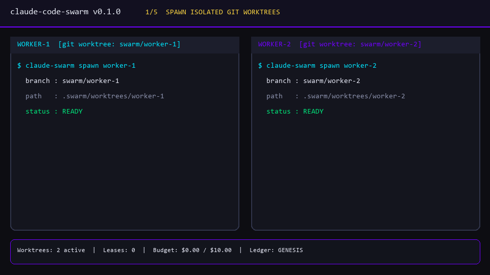

<div align="center">


<br/>

[](#-benchmarks--lease-contention-matrix)
[](https://www.python.org/)
[-00E5FF?style=for-the-badge)](pyproject.toml)
[](#-native-mcp-server--claude-code-hooks)
[](LICENSE)
[](https://benni-os.net)

<br/>

> **Zero-Dependency Multi-Agent Orchestration Kernel for Parallel Claude Code Sessions.**  
> Run multiple Claude Code workers in parallel on isolated `git worktree` sandboxes with SQLite3 WAL file leases, a typed DAG blackboard, a global USD circuit breaker, and a pre-merge AST verification gate.

<br/>



</div>

---

## ⚡ Why claude-code-swarm?

Running parallel **Claude Code** sessions on the same repository without coordination leads to **silent file overwrites**, **broken syntax merges**, and **runaway API spend**.

**`claude-code-swarm`** eliminates all three with a deterministic, zero-dependency Python 3.10+ stdlib kernel:

- **Isolated `git worktree` Sandboxes (`swarm/<worker_id>`)** — Every parallel Claude Code worker operates in its own `.swarm/worktrees/<worker_id>` directory and branch, with one-command diffing, gated merging, and cleanup.
- **SQLite3 WAL File & Directory Lease Arbiter** — Sub-millisecond `BEGIN IMMEDIATE` pessimistic (`exclusive`) and optimistic (`shared`) locks with hierarchical directory-prefix conflict detection and TTL expiration.
- **Typed DAG Blackboard & Handoffs** — Workers atomically claim ready tasks only after upstream DAG dependencies are `resolved`, and exchange structured handoff artifacts.
- **Global Swarm USD/Token Circuit Breaker** — Enforces a shared USD and token cap across all parallel workers with per-worker quotas.
- **Pre-Merge AST Gate & SHA-256 Audit Ledger** — Scans for git conflict markers (`<<<<<<<`, `=======`, `>>>>>>>`), parses Python ASTs (`ast.parse`), optionally runs `pytest`, and chains every decision into an immutable SHA-256 JSONL ledger (`GENESIS_HASH`).
- **One-Command Claude Code Injection (`claude-swarm init`)** — Idempotently configures `.claude/settings.json` (`PreToolUse`, `PostToolUse`, `Stop`, `SubagentStop`), `.mcp.json`, `CLAUDE.md`, and `/swarm-*` slash commands.

---

## 🏗️ Architecture

```text
  Parallel Claude Code Sessions (worker-1, worker-2, ..., worker-N)
         │
         ├──► Claude Code Hooks (PreToolUse / PostToolUse / Stop / SubagentStop)
         └──► STDIO JSON-RPC 2.0 MCP Server (claude-swarm mcp)
                       │
                       ▼
  ┌─────────────────────────────────────────────────────────────────────┐
  │                       claude-code-swarm Kernel                      │
  │                                                                     │
  │  ┌───────────────────┐  ┌───────────────────┐  ┌─────────────────┐  │
  │  │  WorktreeManager  │  │   LeaseArbiter    │  │   Blackboard    │  │
  │  │ • swarm/<id>      │─►│ • SQLite3 WAL     │─►│ • Typed DAG     │  │
  │  │ • Diff & Cleanup  │  │ • Prefix Locking  │  │ • Atomic Claim  │  │
  │  └───────────────────┘  └───────────────────┘  └─────────────────┘  │
  │                                                                     │
  │  ┌───────────────────┐  ┌───────────────────┐  ┌─────────────────┐  │
  │  │    SwarmBudget    │  │     MergeGate     │  │ Telemetry &     │  │
  │  │ • Global USD Cap  │  │ • ast.parse()     │  │ HealthMonitor   │  │
  │  │ • Circuit Breaker │  │ • SHA-256 Ledger  │  │ • P50/P90/P99   │  │
  │  └───────────────────┘  └───────────────────┘  └─────────────────┘  │
  └─────────────────────────────────────────────────────────────────────┘
         │                                         │
         ▼                                         ▼
   .swarm/worktrees/<worker_id>             .swarm/swarm.db (WAL)
   Isolated Git Branches                    + audit_ledger.jsonl
```

---

## 🚀 60-Second Quickstart

```bash
# 1. Clone and install (zero runtime dependencies)
git clone https://github.com/Benni-OS/claude-code-swarm
cd claude-code-swarm
pip install -e .

# 2. Verify environment & SQLite3 WAL lease pipeline
claude-swarm doctor

# 3. Inject Claude Code hooks, .mcp.json, CLAUDE.md & /swarm-* commands
claude-swarm init

# 4. Spawn isolated parallel workers
claude-swarm spawn worker-1
claude-swarm spawn worker-2

# 5. Run the multi-worker lease contention benchmark matrix
claude-swarm matrix

# 6. Merge a verified worker branch through the pre-merge AST gate
claude-swarm merge worker-1 --run-tests
```

### Key CLI Commands

```bash
claude-swarm init                                # Idempotently inject .claude/settings.json, .mcp.json, CLAUDE.md & /swarm-*
claude-swarm spawn worker-1 --base HEAD          # Create isolated git worktree on branch swarm/worker-1
claude-swarm status                              # Show active worktrees, SQLite WAL leases, DAG tasks & USD budget
claude-swarm merge worker-1 --run-tests          # Run pre-merge AST/conflict gate + tests and merge swarm/worker-1
claude-swarm cleanup worker-1 --force            # Remove worker worktree and delete swarm/worker-1 branch
claude-swarm hook PreToolUse                     # Dispatch official Claude Code hook JSON from stdin
claude-swarm mcp                                 # Launch zero-dependency JSON-RPC 2.0 stdio MCP server
claude-swarm doctor                              # Full environment, SQLite WAL probe & ledger diagnostic
claude-swarm matrix --workers 2 4 8 --ops 50     # Multi-worker lease contention & latency benchmark matrix
claude-swarm audit                               # Verify the SHA-256 swarm audit ledger from GENESIS_HASH
```

---

## 📊 Benchmarks & Lease Contention Matrix

Measured via `claude-swarm matrix --workers 2 4 8 --ops 40` (SQLite3 WAL, `BEGIN IMMEDIATE`, 25% hot-file contention):

| Parallel Workers | Total Lease Ops | Granted | Conflicts Blocked | P50 Latency | P90 Latency | P99 Latency | Throughput |
|---:|---:|---:|---:|---:|---:|---:|---:|
| **2 Workers** | 80 | 80 | 0 | 17.261 ms | 19.891 ms | 29.963 ms | 112.2 ops/s |
| **4 Workers** | 160 | 153 | 7 | 11.125 ms | 44.185 ms | 130.570 ms | 136.8 ops/s |
| **8 Workers** | 320 | 269 | 51 | 17.513 ms | 66.230 ms | 412.977 ms | 139.1 ops/s |

> Run `claude-swarm matrix` or `python scripts/benchmark_swarm_leases.py` locally to measure exact P50/P90/P99 timings on your disk & CPU.

---

## 🔌 Native MCP Server & Claude Code Hooks

### Exposed MCP Tools (`claude-swarm mcp`)

| Tool | Purpose |
|---|---|
| `swarm_claim_task` | Atomically claim the next ready task whose DAG dependencies are `resolved` |
| `swarm_acquire_lock` | Acquire an `exclusive` or `shared` SQLite3 WAL file/directory lease |
| `swarm_release_lock` | Release a held lease for a worker |
| `swarm_post_handoff` | Post a typed handoff summary and artifact list between workers |
| `swarm_budget_check` | Check global swarm USD/token cap and per-worker quota |
| `swarm_merge_ready` | Run the pre-merge AST, conflict-marker, and optional test gate on a worktree |
| `swarm_status` | Return active worktrees, leases, tasks, budget, and P50/P90/P99 telemetry |

### Official Claude Code Hooks (`claude-swarm hook <Event>`)

- **`PreToolUse`**: Enforces global/worker USD budget caps and acquires exclusive SQLite WAL leases on `Write`, `Edit`, `MultiEdit`, `NotebookEdit`, and write-targeted `Bash` commands. Returns exit code `2` + `permissionDecision: "deny"` on collision.
- **`PostToolUse`**: Records incremental USD and token spend when usage metadata is present.
- **`Stop` / `SubagentStop`**: Automatically releases all leases held by the exiting worker and appends to the SHA-256 audit ledger.

---

## 🗂️ Project Structure

```text
claude-code-swarm/
├── src/
│   └── claude_code_swarm/
│       ├── __init__.py               # Package exports & version metadata
│       ├── cli.py                    # CLI entrypoint (init, spawn, status, merge, cleanup, hook, mcp, doctor, matrix, audit)
│       ├── core/
│       │   ├── __init__.py
│       │   ├── blackboard.py         # Shared typed task DAG & handoff blackboard (SQLite3 WAL)
│       │   ├── hook_engine.py        # Claude Code PreToolUse/PostToolUse/Stop/SubagentStop dispatcher
│       │   ├── injector.py           # Idempotent .claude/settings.json, .mcp.json, CLAUDE.md & /swarm-* injector
│       │   ├── lease_arbiter.py      # SQLite3 WAL pessimistic/optimistic file & directory lock arbiter
│       │   ├── merge_gate.py         # Pre-merge AST & conflict-marker gate + SHA-256 audit ledger
│       │   ├── swarm_budget.py       # Global USD/token cap & per-worker quota circuit breaker
│       │   └── worktree_manager.py   # Real git worktree lifecycle manager (swarm/<worker_id>)
│       ├── serve/
│       │   ├── __init__.py
│       │   ├── health_monitor.py     # Worktree, SQLite3 WAL & SHA-256 ledger health monitor
│       │   ├── mcp_server.py         # Zero-dependency JSON-RPC 2.0 stdio MCP server
│       │   └── telemetry.py          # Rolling P50/P90/P99 latency & conflict prevention telemetry
│       └── tools/
│           ├── __init__.py
│           ├── bench_matrix.py       # Multi-worker lease contention benchmark matrix
│           └── doctor.py             # Full swarm environment & lease pipeline diagnostic
├── docs/
│   └── ARCHITECTURE.md               # Deep-dive subsystem & protocol specification
├── examples/
│   ├── quickstart_parallel_swarm.py  # Parallel worktree + DAG blackboard + merge gate demo
│   └── quickstart_lease_conflict_demo.py # PreToolUse hook collision blocking demo
├── scripts/
│   ├── benchmark_swarm_leases.py     # Standalone multi-worker contention benchmark
│   └── gate_swarm_integrity.py       # End-to-end invariant verification gate
├── assets/
│   └── demo.gif                      # Animated parallel worktree & lease demo
├── tests/                            # Full pytest suite (30 tests)
├── pyproject.toml                    # Zero-dependency PEP 621 package config
├── LICENSE                           # MIT License (Benni Alencar)
└── README.md
```

---

## 🌍 Part of the Benni OS Ecosystem

`claude-code-swarm` is part of the coordinated **Benni Master OS v9.4** open-source infrastructure suite:

| Repository | Focus & Architecture | Stars |
| :--- | :--- | :---: |
| **[`claude-code-swarm`](https://github.com/Benni-OS/claude-code-swarm)** | Zero-Dependency Multi-Agent Worktree & SQLite WAL Lease Kernel for Claude Code | [](https://github.com/Benni-OS/claude-code-swarm) |
| **[`claude-code-sovereign`](https://github.com/Benni-OS/claude-code-sovereign)** | Zero-Dependency Runtime Governance Kernel, Prompt-Injection Firewall & Time-Travel Replay | [](https://github.com/Benni-OS/claude-code-sovereign) |
| **[`conductor-sdd`](https://github.com/Benni-OS/conductor-sdd)** | Zero-Dependency Spec-Driven Development, Static AST Drift Detector & MCP Guardrail | [](https://github.com/Benni-OS/conductor-sdd) |
| **[`benni-inference-engine`](https://github.com/Benni-OS/benni-inference-engine)** | High-Throughput Sovereign Local Inference for 8GB–16GB Consumer GPUs | [](https://github.com/Benni-OS/benni-inference-engine) |

---

## 🏛️ Commercial & Sovereign Architecture

Need autonomous multi-agent swarm orchestration, private datacenter infrastructure, or enterprise governance?

- **Official Website:** [https://benni-os.net](https://benni-os.net)
- **Operator Mode Playbook:** [https://benni-os.net/blog/academy.html](https://benni-os.net/blog/academy.html)
- **GitHub Organization:** [https://github.com/Benni-OS](https://github.com/Benni-OS)
- **Maintainer:** [Benni Alencar](https://github.com/BenniAlencar)

---

## 📄 License & Provenance

- **License:** [MIT License](LICENSE)
- **Author:** Benni Alencar (`bennialencar@benni-os.net`)
- **Architecture:** Benni Master OS v9.4 Tier-0 Governance Standard

<div align="center">


**claude-code-swarm** — *Zero-Dependency Multi-Agent Orchestration Kernel for Claude Code* • [benni-os.net](https://benni-os.net) • `MIT License`

</div>
